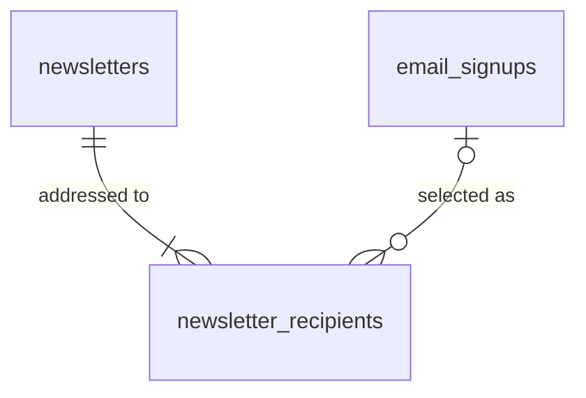
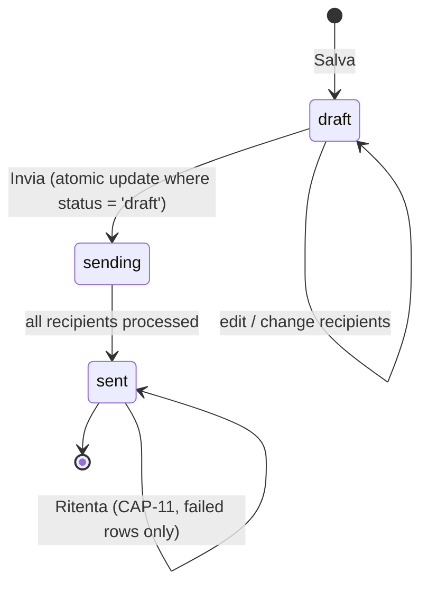

# Data model — Newsletter (APPROVED 2026-09-27)

Postgres (Supabase, schema `public`). Existing table reused; two new tables.

## Tables

### `email_signups` (existing — landing Story 1.5)
| column | type | notes |
|---|---|---|
| id | uuid PK default `gen_random_uuid()` | |
| email | text not null | unique index on `lower(email)`; landing stores lowercase |
| created_at | timestamptz not null default `now()` | signup date shown in Clienti |
| source | varchar(16) null | `landing` / `quiz`; check constraint; sent by the landing form |
| consent_given_at | timestamptz null default `now()` | set by the database, anon cannot write it |
| consent_text_version | varchar(64) null | version of the consent text accepted; sent by the landing form |

Consent proof (migration 20261008120000): the three columns are null only on rows created before it (no proof of consent exists for them). Anon inserts must carry `source` and `consent_text_version`; `consent_given_at` and `consent_text_version` are null together or set together.

Change (migration in this repo — backoffice owns the schema from now on): admin policies select/update/delete `using is_admin()`. No admin insert (manual add is TODO, pending iubenda).

Landing insert (migration 20260928090000, extended by 20261008120000): the form writes with the publishable key as `anon`. Anon has insert on columns `email`, `source`, `consent_text_version` only, under a policy requiring a lowercase trimmed email ≤ 254 chars and both `source` and `consent_text_version` present. It cannot set `id`, `created_at` or `consent_given_at`, and has no select, update or delete.

### `newsletters`
| column | type | notes |
|---|---|---|
| id | uuid PK | |
| subject | varchar(255) not null | |
| body | text not null | plain text |
| status | varchar(16) not null default `'draft'` | `draft` / `sending` / `sent`; check constraint |
| sent_at | timestamptz null | set on `sent` |
| created_at / updated_at | timestamptz | |

List status derived: `draft` → Bozza; `sending` → In invio; `sent` + 0 failed → Inviata; `sent` + ≥1 failed → Inviata con errori (sent/failed counts from `newsletter_recipients`).

### `newsletter_recipients`
| column | type | notes |
|---|---|---|
| id | uuid PK | |
| newsletter_id | uuid not null FK → `newsletters.id` on delete cascade | |
| signup_id | uuid null FK → `email_signups.id` on delete set null | null after subscriber deleted |
| email | text not null | copied on selection, refreshed from `email_signups` at send (step 3); final value = what was actually addressed |
| delivery_status | varchar(16) not null default `'pending'` | `pending` / `sent` / `failed` |
| delivered_at | timestamptz null | |
| error | varchar(255) null | provider error on failure |

Unique `(newsletter_id, signup_id)`; unique `(newsletter_id, lower(email))` so no address is addressed twice. Deleting a subscriber removes their rows from **draft** newsletters (trigger or delete policy); rows of sent newsletters stay with `signup_id` null.

## Relationships

## Send lifecycle

Edge Function `send-newsletter(newsletter_id)`:
1. Verify caller `is_admin()`.
2. `update newsletters set status='sending' where id=$1 and status='draft' returning id` — 0 rows → refuse (already sent / sending).
3. Refresh `newsletter_recipients.email` from `email_signups`; send one message per row with `delivery_status='pending'` via Resend (batch API allowed: still one message per recipient, alone in `To`), header `Idempotency-Key: <newsletter_id>:<recipient_id>`.
4. Mark each row `sent`/`failed`; then newsletter `sent`, `sent_at = now()`.

Retry (CAP-11, secondary): same function with `retry=true` on a `sent` newsletter; processes only rows `delivery_status='failed'`, sets them back to `pending` atomically before sending.

## Security

- RLS on all three tables: admin-only via `is_admin()`. `anon` has no access, except the insert-only path on `email_signups` described above.
- Audit: trigger `write_audit_log()` (migration 20260927120000) attached to all three tables.
- `RESEND_API_KEY` only as Edge Function secret.
