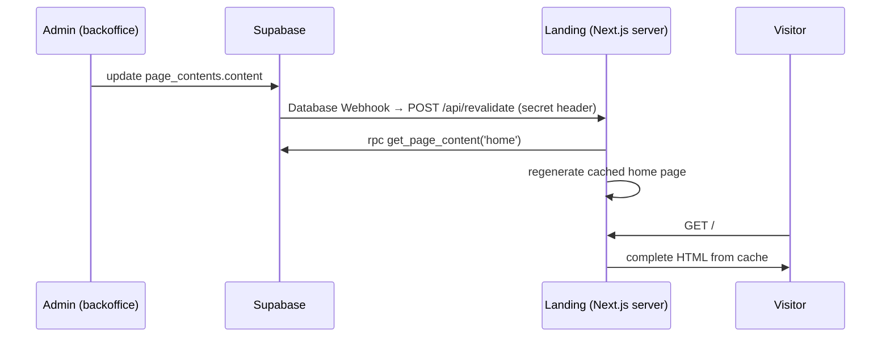

# Data model — Page contents (WRITTEN, NOT APPLIED: migration 20261013120000)

Postgres (Supabase, schema `public`). One new table, one RPC, one storage bucket.

## Table

### `page_contents`
| column | type | notes |
|---|---|---|
| id | uuid PK default `gen_random_uuid()` | used by Refine and by `audit_log.record_id` |
| slug | varchar(64) not null unique | page identifier, lowercase kebab-case (`home`); check constraint |
| content | jsonb not null | the page document; check `jsonb_typeof = 'object'` |
| created_at / updated_at | timestamptz | `updated_at` bumped by `set_updated_at()` only on real change |

One row per landing page. Rows are seeded by migration (`home`, with the copy that was hard-coded in the landing). No insert or delete from the app.

## Page documents

The shape of `content` depends on the page. The database does not validate it: the backoffice form does (zod), and the landing treats it as untrusted input with per-field fallback.

### `home`
```json
{
  "title": "La strada più veloce per vincere la farmacia.",
  "subtitle": "3000 domande ufficiali. Le ricordi con la mnemotecnica, non le rileggi all'infinito.",
  "cta": { "label": "Prova il quiz gratis", "note": "Nessuna registrazione richiesta" },
  "stats": [
    { "value": "3000", "label": "domande ufficiali" },
    { "value": "2 min", "label": "per il quiz gratuito" },
    { "value": "0", "label": "login richiesti" }
  ],
  "hero_image": { "path": "a1b2c3.png", "alt": "Il cervo Remindeer in camice…" }
}
```

| field | rule |
|---|---|
| title | required, ≤ 120 chars |
| subtitle | required, ≤ 300 chars |
| cta.label | required, ≤ 40 chars |
| cta.note | optional (empty string when unset), ≤ 80 chars |
| stats | 0 to 4 items, in display order; `value` ≤ 12 chars, `label` ≤ 40 chars, both required |
| hero_image | `null` = the landing shows its bundled default image; otherwise `path` + `alt` (required, ≤ 255 chars) |

`hero_image.path` is an object path in the bucket `page-images`. Public URL: `{SUPABASE_URL}/storage/v1/object/public/page-images/{path}`.

## API

`get_page_content(p_slug text) returns jsonb` — anon + authenticated, security definer. Returns the page document plus `updated_at` (ISO timestamp), or `null` when the slug is unknown. Never raises for a missing page.

```
POST {SUPABASE_URL}/rest/v1/rpc/get_page_content
{ "p_slug": "home" }
```

## Storage

Bucket `page-images`: **public**, 5 MB limit, PNG / JPEG / WebP. Objects are named `<uuid>.<ext>` and read by public URL. Public because the landing caches the rendered page, and a signed URL (as used for `question-images`) would expire inside the cache. Not registered in the `images` table, which describes the private bucket only.

Replacing or removing the hero image leaves the old object in the bucket (no cleanup): the audit log can still point at it.

## Flow



Landing side (webhook, revalidation endpoint, fallback) is specified and built in the landing repo.

## Security

| object | anon | authenticated non-admin | admin |
|---|---|---|---|
| `page_contents` table | no access | no rows | read, update |
| `get_page_content()` | execute | execute | execute |
| `page-images` objects | read by public URL | read by public URL | read, upload, delete |

- RLS on `page_contents`: `admin read`, `admin update` via `is_admin()`. No insert/delete policy.
- Audit: trigger `write_audit_log()` on `page_contents`.
- Everything in a page document and in `page-images` is public by design. Never store anything there that must stay private.
