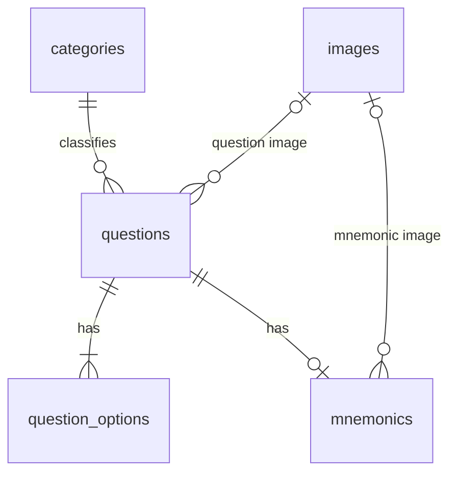

# Data model — Questions CRUD (APPROVED 2026-09-27)

Postgres (Supabase, schema `public`). English names; concepts map to Roadmap §3 (`domanda`, `opzione`, `categoria`, `mnemotecnica`).

## Tables

### `categories`
| column | type | notes |
|---|---|---|
| id | uuid PK default `gen_random_uuid()` | |
| name | varchar(255) not null unique | e.g. "Tecnologia farmaceutica", "Legislazione" |
| created_at | timestamptz not null default `now()` | |

Seeded by migration. Roadmap fields (`slug`, `criteri_di_inclusione/esclusione`, `colore`, `ordine`) deferred to categories spec.

### `images`
| column | type | notes |
|---|---|---|
| id | uuid PK | |
| storage_path | varchar(255) not null unique | object key in bucket `question-images` |
| file_name | varchar(255) not null | original name, e.g. `3000 microcapsule coacervazione.png` |
| mime_type | varchar(255) not null | `image/png`, `image/jpeg`, `image/webp` |
| size_bytes | integer not null | |
| created_at | timestamptz not null default `now()` | |

One row per uploaded file. Questions and mnemonics reference `images.id` → image picked from DB (existing) or uploaded (new row).

### `questions`
| column | type | notes |
|---|---|---|
| id | uuid PK | |
| official_number | integer not null unique, `> 0` | "numero domanda" (3000, 953); re-import anchor |
| text | varchar(500) not null | "testo domanda" |
| image_id | uuid null FK → `images.id` on delete set null | optional question image |
| category_id | uuid not null FK → `categories.id` on delete restrict | |
| is_free | boolean not null default false | true = visible to free users; false = paid only (PRD FR-25) |
| created_at | timestamptz not null default `now()` | |
| updated_at | timestamptz not null default `now()` | trigger-maintained |

### `question_options`
| column | type | notes |
|---|---|---|
| id | uuid PK | answer always addressed by id, never by position |
| question_id | uuid not null FK → `questions.id` on delete cascade | |
| text | varchar(255) not null | |
| is_correct | boolean not null default false | |
| position | smallint not null | original order in source (1..n); unique `(question_id, position)` |

Option count varies per question: 2–10, checked in zod and in `save_question`.

Constraints:
- partial unique index `(question_id) where is_correct` → max one correct option per question.
- "exactly one correct" + option count enforced in form (zod) and in a save RPC (see Write path).

### `mnemonics`
| column | type | notes |
|---|---|---|
| id | uuid PK | |
| question_id | uuid not null FK → `questions.id` on delete cascade | unique now (one mnemonic per question); drop unique when variants arrive |
| text | varchar(255) null | "testo mnemotecnica" |
| image_id | uuid null FK → `images.id` on delete set null | "immagine mnemotecnica" |
| created_at / updated_at | timestamptz | |

Check: `text is not null or image_id is not null`. Covers both example shapes: #3000 image+text, #953 text only.

### `audit_log`
| column | type | notes |
|---|---|---|
| id | bigint identity PK | |
| actor_id | uuid | `auth.uid()` of the admin |
| action | varchar(16) | insert / update / delete |
| table_name | varchar(255) | |
| record_id | uuid | |
| old_data / new_data | jsonb | row before / after |
| created_at | timestamptz | |

Written only by `security definer` trigger on every content table; admins read-only.

## Relationships

## Examples mapped

| field | #3000 | #953 |
|---|---|---|
| questions.official_number | 3000 | 953 |
| questions.text | Quale tra i metodi indicati può essere impiegato per la preparazione di microcapsule | Ogni quanti anni è prevista la revisione della F.U. |
| questions.image_id | null | null |
| category | Tecnologia farmaceutica | Legislazione |
| questions.is_free | (not given → default false) | (not given → default false) |
| options (is_correct ✓) | coacervazione ✓, liofilizzazione, polverizzazione, granulazione, atomizzazione | ogni anno, ogni 2 anni, ogni 4 anni, ogni 5 anni ✓, ogni 8 anni |
| mnemonics.text | un cervo (coacervazione) che prepara microcapsule | conta le sillabe: Far-ma-co-pe-a = 5, quindi ogni 5 anni |
| mnemonics.image_id | → images(`3000 microcapsule coacervazione.png`) | null |

## Write path

Question + options + mnemonic saved atomically: Postgres function `save_question(payload jsonb)` (security invoker, one transaction), called via `providers/custom/` (ADR-003). Plain Refine data provider handles list, getOne (with embedded `question_options`, `mnemonics`, `categories`) and delete (cascade).

Image upload: Supabase Storage upload + `images` insert, both via `providers/custom/`.

## Security

- RLS enabled on all tables; policy `authenticated` → select/insert/update/delete. No `anon` access in this scope (landing public read policies = separate concern).
- Storage bucket `question-images`: private-by-default read for `authenticated`; write for `authenticated`. Max size 5 MB, mime whitelist png/jpeg/webp.
